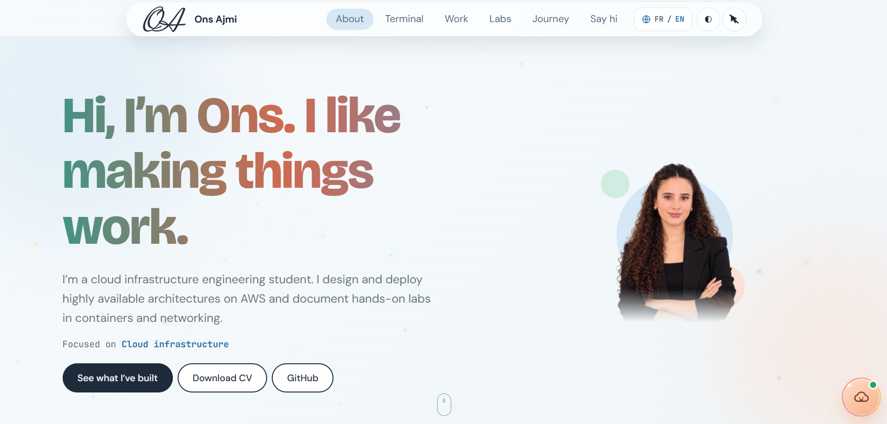
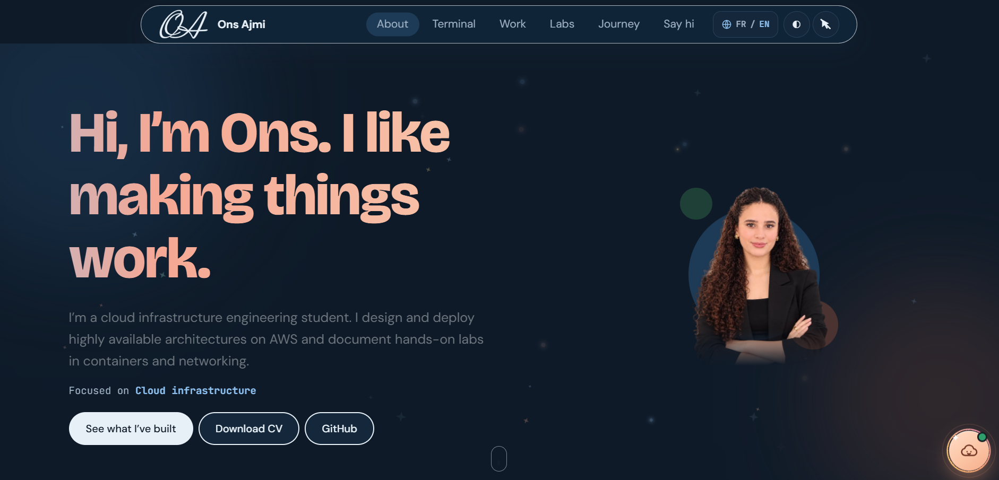
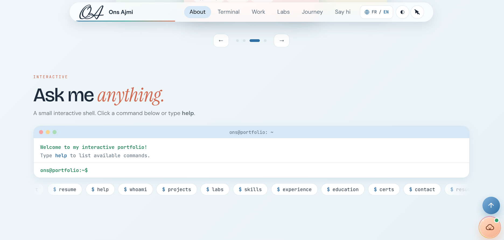
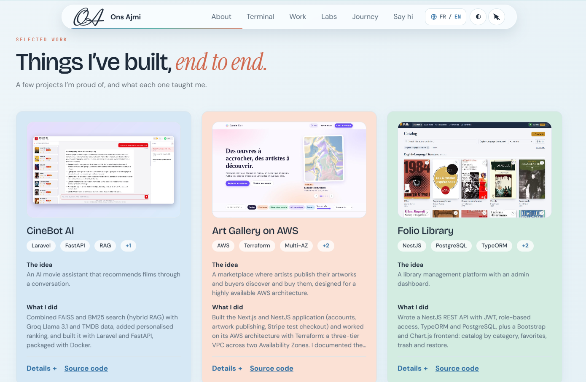
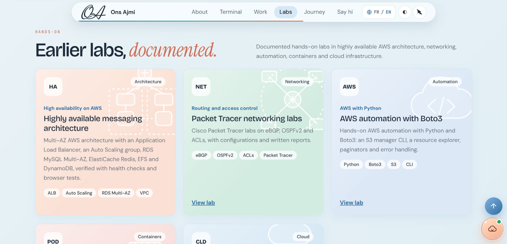
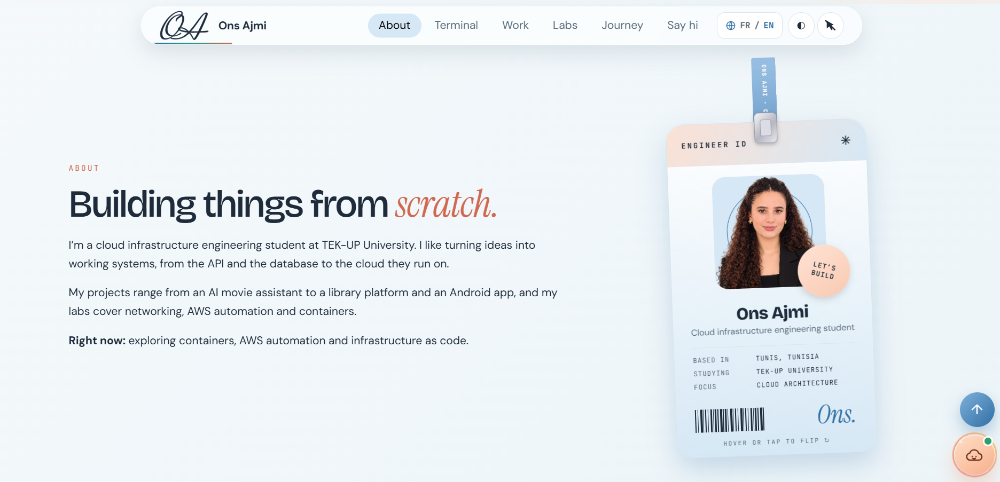
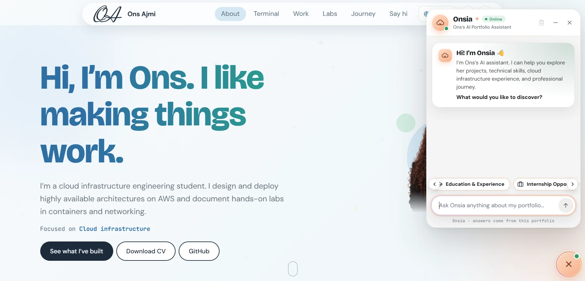
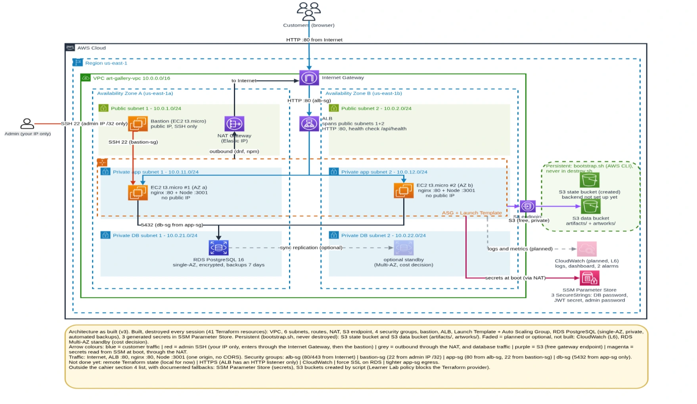

# Ons Ajmi | Portfolio

## Overview

A personal portfolio website built with plain **HTML, CSS and JavaScript** (Bootstrap 5). It presents my full-stack projects, documented cloud and networking labs, skills and learning journey, and includes **Onsia**, an AI assistant that answers questions about my work.

## Demo 🎥



🚀 **[View Live Demo ; Vercel deployment](https://ons-ajmi-portfolio.vercel.app/)**

### Screenshots

| Light and dark mode | Interactive terminal |
| --- | --- |
|  |  |

| Projects | Labs |
| --- | --- |
|  |  |

| About | Contact |
| --- | --- |
|  |  |

### Onsia, the AI portfolio assistant



### Architecture of Art Gallery on AWS



## Features ✨

- ✅ **Onsia AI Assistant:** a floating chat that answers questions about my projects, labs, skills, education and contact details
- ✅ **Fully Responsive:** works on phones, tablets and desktops, with a keyboard-aware chat on mobile
- ✅ **Bilingual:** English and French, switched with one click
- ✅ **Light and Dark Mode:** switch themes with one click
- ✅ **Project Showcase:** compact cards, a details window per project, filterable by technology
- ✅ **Architecture Diagram Viewer:** the AWS design of Art Gallery with its key numbers, zoomable
- ✅ **Hands-on Labs:** documented cloud, networking and container labs
- ✅ **Certification Path:** shows only real status (obtained or in preparation)
- ✅ **Latest GitHub Repos:** fetched live from the GitHub API
- ✅ **Interactive Terminal:** an "Ask my terminal" section to explore my profile
- ✅ **Animated Hero:** portrait that reacts to the cursor, plus a custom cursor
- ✅ **Downloadable CV:** one-click PDF download
- ✅ **Share the portfolio:** footer menu to send the link by email, WhatsApp, Messenger or Instagram, or copy it
- ✅ **Accessible:** skip link, keyboard navigation, ARIA labels, reduced-motion support
- ✅ **SEO Ready:** meta description, Open Graph, structured data, `sitemap.xml` and `robots.txt`
- ✅ **Free Hosting:** deployed on Vercel

## Sections 🔖

| Section | Description |
| --- | --- |
| 🦸 **Hero** | Introduction with an animated portrait |
| 💻 **Ask my terminal** | Interactive terminal to explore my profile |
| 🚀 **Projects** | Things I've built, with descriptions, key numbers and repo links |
| 🧪 **Labs** | Hands-on labs in networking, AWS and containers |
| 🧭 **Journey** | Education, experience and certification path |
| 👤 **About Me** | Personal summary and my toolbox |
| 📧 **Contact** | Email and LinkedIn links |
| 🤖 **Onsia** | AI assistant available on every page |

## Table of Contents 📜

- [Overview](#overview)
- [Demo](#demo-)
- [Features](#features-)
- [Sections](#sections-)
- [Featured Projects](#featured-projects-)
- [Onsia AI Assistant](#onsia-ai-assistant-)
- [Project Structure](#project-structure-)
- [Run Locally](#run-locally-)
- [Tech Stack](#tech-stack-)
- [Contact](#contact-)

## Featured Projects 🏆

| Project | Description | Stack | Code |
| --- | --- | --- | --- |
| **CineBot AI** | AI movie assistant that recommends films through conversation (hybrid RAG) | Laravel, FastAPI, FAISS, BM25, Docker | [Repo](https://github.com/AjmiOns/CineBot-AI) |
| **Art Gallery on AWS** | Marketplace where artists publish artworks and buyers purchase them | Next.js, NestJS, PostgreSQL, AWS | [Repo](https://github.com/AjmiOns/art-gallery-aws) |
| **Folio Library** | Library management platform with an admin dashboard | NestJS, PostgreSQL, TypeORM, Bootstrap, Chart.js | [Repo](https://github.com/AjmiOns/folio-library) |
| **To-do list Android app** | Android task manager backed by my own REST API | Java, Retrofit, PHP, MySQL | [Repo](https://github.com/AjmiOns/todolist-android-app) |

**Art Gallery on AWS in numbers:** 41 Terraform resources, 2 Availability Zones, 6 subnets, 4 security groups, 7 days of automated database backups. The infrastructure is built and destroyed with Terraform every session. Still to do: HTTPS on the load balancer, remote Terraform state and CloudWatch monitoring.

### Hands-on Labs

| Lab | Topics | Code |
| --- | --- | --- |
| **Packet Tracer networking labs** | eBGP, OSPFv2, ACLs | [Repo](https://github.com/AjmiOns/packet-tracer-labs) |
| **AWS automation with Boto3** | S3 manager CLI, resource explorer, paginators | [Repo](https://github.com/AjmiOns/boto3-aws-academy-learner-lab) |
| **Containers on Linux with Podman** | Namespaces, cgroups, OCI, Podman | [Repo](https://github.com/AjmiOns/conteneurisation-linux-podman) |
| **Cloud infrastructure labs** | OpenStack, AWS (EC2, EBS, VPC) | [Repo](https://github.com/AjmiOns/infrastructures-cloud-aws-learner-lab) |

### Certifications

AWS Certified Cloud Practitioner and AWS Certified Solutions Architect Associate are **in preparation**. None is listed as obtained yet.

## Onsia AI Assistant 🤖

Onsia is the assistant in the bottom-right corner. It answers only from the content of this portfolio.

- **Quick actions:** a carousel of shortcuts (projects, labs, skills, education, internships, contact)
- **Real AI replies:** the chat calls a Vercel serverless function (`api/chat.js`) that uses the Anthropic API
- **Built-in fallback:** if the API is unreachable or no key is set, Onsia still answers from the portfolio data, and a notice says so
- **Conversation tools:** Markdown replies, typing indicator, minimize, and a button to clear the conversation (kept per browser tab until cleared)
- **Mobile friendly:** the chat follows the visible area when the keyboard opens, and the input never triggers the iOS zoom
- **Bilingual:** follows the language selected on the site

To enable the AI replies on your own deployment, add an `ANTHROPIC_API_KEY` environment variable in the Vercel project settings, then redeploy.

## Project Structure 🗂️

```text
.
├── index.html            # Page structure
├── css/
│   ├── style.css         # Site styles
│   └── onsia.css         # Onsia chat styles
├── js/
│   ├── config.js         # All the content (projects, labs, skills, links)
│   ├── i18n.js           # French translations
│   ├── app.js            # Site behaviour (cards, terminal, dialogs, theme)
│   └── onsia.js          # Onsia assistant
├── api/
│   └── chat.js           # Serverless function for the AI replies
├── vendor/               # Bootstrap 5.3.3 (served locally, no CDN)
├── tools/
│   └── check-i18n.js     # Lists text still in English on the French page
├── vercel.json           # Security headers
├── images/               # Project images and architecture diagram
├── screenshots/          # Screenshots used in this README
├── cv.pdf
├── sitemap.xml
└── robots.txt
```

To update the content (a new project, a certification obtained, a link), edit `js/config.js`. French texts live in `js/i18n.js`; after a change, run `node tools/check-i18n.js` (with the site served locally) to catch anything left in English.

## Run Locally 🛠️

The site is static, so any local server works:

```bash
python -m http.server 8000
```

Then open `http://localhost:8000`. The AI replies need the serverless function: run `vercel dev` with an `ANTHROPIC_API_KEY` set, otherwise Onsia uses its built-in answers.

## Tech Stack 💻

### This Website

| Technology | Purpose |
| --- | --- |
| HTML5 | Page structure |
| CSS3 | Custom styling and animations |
| JavaScript (ES6+) | Dynamic content, terminal, Onsia, GitHub API |
| Bootstrap 5.3 | Responsive layout and components (self-hosted) |
| Vercel | Hosting and serverless function |
| Anthropic API | AI replies of the Onsia assistant |

### My Skills

| Category | Technologies |
| --- | --- |
| **Languages** | Java, PHP, Python, JavaScript, TypeScript, SQL |
| **Frameworks** | Laravel, NestJS, FastAPI, Next.js, Bootstrap, RAG |
| **Cloud and DevOps** | AWS, Terraform, Boto3, Docker, Podman, OpenStack, Linux |
| **Networking and data** | BGP, OSPF, ACLs, Packet Tracer, PostgreSQL, MySQL |

## Contact 📬

- 📧 Email: [ajmions241@gmail.com](mailto:ajmions241@gmail.com)
- 💼 LinkedIn: [Ons Ajmi](https://www.linkedin.com/in/ons-ajmi--/)
- 🐙 GitHub: [@AjmiOns](https://github.com/AjmiOns)

---

⭐ If you like this portfolio, feel free to star the repository!
